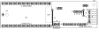

# Foreword

Team sevenUP prepares and maintains the hardware documents of the Vantage sensor node. The design files, the
drawings and these documents are kept together in the team hardware repository, so that every hardware
revision has a matching set of documents.

This document was prepared by Team sevenUP.

This first edition applies to Rev A of the sensor board. A new edition is issued whenever the sensor board
revision changes. The changes between revisions are recorded in the repository change log (`CHANGELOG.md`).

Questions and proposed changes to this document should be raised as issues in the hardware repository.

# Introduction

The Vantage sensor node is the field unit of a flood-monitoring system. It measures water level, rainfall and
ambient conditions and sends the data over Wi-Fi. The node is built from two boards connected by one cable:

- the **sensor board**, which carries an ESP32-S3 development board and the interfaces to the sensors;
- the **power board**, which carries the battery, the solar charger, the regulators and the power monitoring
  (see VNT-002).

The sensor board is designed to be made by hand with the toner-transfer method. It therefore has a single
copper layer, wide tracks and gaps, large pads and hand-solderable parts. Two short wire links on the
component side complete the ground connections that a single copper layer cannot make.

This document gives the procedure to make the board, to assemble it, to configure it and to check that it
works. The design files themselves are listed in Clause 2.

# 1 Scope

This document specifies the fabrication, assembly, configuration, inspection and testing of the Vantage sensor
board, Rev A.

It applies to boards made by toner transfer and wet etching on single-sided copper laminate. It does not
cover the power board (see VNT-002), the firmware, or the mechanical enclosure, except where the sensor board
places requirements on them.

# 2 Normative references

The following documents are referred to in the text in such a way that some or all of their content
constitutes requirements of this document. For each, the Rev A file in the hardware repository applies.

- `sensor-board/Vantage_Sensor.kicad_sch`, *Vantage — Sensor board — Schematic*
- `sensor-board/Vantage_Sensor.kicad_pcb`, *Vantage — Sensor board — PCB layout*
- `outputs/sensor-board/Vantage_Sensor_Copper-Artwork_Letter.pdf` and `…_A4.pdf`, *Vantage — Sensor board — Copper artwork, 1:1*
- `outputs/sensor-board/Vantage_Sensor_Assembly-Drawing.pdf`, *Vantage — Sensor board — Assembly drawing*
- `outputs/sensor-board/Vantage_Sensor_BOM.csv`, *Vantage — Sensor board — Bill of materials*
- VNT-002, *Vantage — Power board — Description and test*

# 3 Terms and definitions

For the purposes of this document, the following terms and definitions apply.

### 3.1

**component side**

side of the board on which the through-hole components and the development board are placed

Note 1 to entry: The component side carries no copper pattern, only the two wire links.

### 3.2

**copper side**

side of the board that carries the copper pattern; the surface-mount components are soldered on this side

### 3.3

**copper artwork**

1:1 printed image of the copper pattern, used as the etch resist in toner transfer

### 3.4

**toner transfer**

method of making a printed circuit board in which laser-printer toner is transferred onto copper laminate by
heat and pressure and then serves as the etch resist

### 3.5

**wire link**

short piece of bare tinned wire on the component side that joins two copper areas which the single copper
layer cannot join

### 3.6

**jumper**

pair of header pins that is closed by a removable jumper cap

### 3.7

**dev board**

ESP32-S3 development board (YD-ESP32-S3, ESP32-S3-DevKitC-1 compatible, N16R8) that plugs into the sockets of U1

### 3.8

**bench mode**

configuration in which the sensor board is powered from the USB port of the dev board only

### 3.9

**field mode**

configuration in which the sensor board is powered by the power board through J1

### 3.10

**sensor 5 V**

5 V supply rail (net V5_SENS) for the ultrasonic module and the TF-Luna

### 3.11

**SENS_EN**

control signal from GPIO21 of the dev board that switches the sensor 5 V on the power board; high level = on

# 4 Abbreviated terms

| Abbreviation | Meaning |
|---|---|
| GPIO | General-purpose input/output |
| I2C | Inter-integrated circuit (two-wire serial bus) |
| PTC | Positive temperature coefficient (resettable) fuse |
| SMD | Surface-mount device |
| THT | Through-hole technology |
| TVS | Transient voltage suppressor (diode) |
| UART | Universal asynchronous receiver-transmitter (serial port) |

# 5 Description

## 5.1 General

The sensor board is a carrier for the dev board. It distributes the supplies, protects the sensor lines and
connects the sensors to the GPIOs of the dev board. Its main characteristics are given in Table 1. The component
side is shown in Figure 1 and the copper side in Figure 2.

Table 1 — Main characteristics

| Characteristic | Value |
|---|---|
| Outline | 110.0 mm × 30.0 mm, rectangular |
| Base material | Single-sided FR-4 copper laminate, 1.6 mm thick, 35 µm copper (recommended) |
| Copper | One layer on the copper side, with a ground fill and thermal reliefs |
| Track width | 0.6 mm for signals, 1.0 mm for supplies and ground |
| Minimum clearance | 0.5 mm copper to copper, 0.8 mm copper to board edge |
| Holes | 72 × 1.0 mm, 2 × 1.2 mm, 2 × 3.2 mm (see Annex B) |
| Wire links | 2 (L1, L2), on the component side |
| Surface-mount parts | 16, all on the copper side (1206, 1812 and SMA packages) |
| Through-hole parts | Dev board sockets (U1), J1 to J5, JP1, JP2 |
| Mounting | 2 × M3: H1 under the dev board, H2 at the J1 end |
| Antenna area | No ground fill under the antenna end of the dev board |

{: .wide}

Figure 1 — Component side (USB end on the left, J1 end on the right)

{: .wide}

Figure 2 — Copper side, seen from the copper side, showing the pads and the surface-mount parts

## 5.2 Interfaces

The connectors and jumpers are listed in Table 2. The pin assignments are given in Annex C.

Table 2 — Connectors and jumpers

| Ref. | Function | Type |
|---|---|---|
| U1 | Dev board | 2 × 22-way female header, 2.54 mm, rows 25.4 mm apart |
| J1 | Power board connection: 3.3 V, sensor 5 V, ground, I2C, SENS_EN | JST XH, 6-way, side entry |
| J2 | AJ-SR04M ultrasonic module (stands upright) | 4-way female header, 2.54 mm |
| J3 | BME280 module (6-pin module) | 6-way female header, 2.54 mm |
| J4 | Rain gauge (reed switch) | 2-way screw terminal, 3.5 mm |
| J5 | TF-Luna LiDAR (optional) | 4-way male header, 2.54 mm |
| JP1 | 3V3 FEED: power-board 3.3 V to the dev board | 2-way male header + jumper cap |
| JP2 | BENCH 5V: dev-board USB 5 V to the sensor 5 V | 2-way male header + jumper cap |

## 5.3 Protection functions

The sensor lines leave the enclosure and are protected as follows:

- the rain-gauge input has a TVS diode (D2, SMAJ6.0A), a 1 kΩ series resistor (R11) and a 100 nF filter
  capacitor (C4);
- the BME280 is supplied from GPIO2 through 100 Ω (R6), so that a short circuit in its cable is limited and the
  sensor can be switched off; its I2C lines have 220 Ω series resistors (R7, R8);
- the ultrasonic trigger and the TF-Luna UART lines have 1 kΩ series resistors (R1, R4, R5); the echo line has a
  divider (R2 10 kΩ, R3 18 kΩ) that reduces the 5 V echo to about 3.2 V;
- the TF-Luna supply has a resettable fuse (F1, 0.2 A);
- the bench 5 V passes through a Schottky diode (D1, SS14) so that the sensor 5 V can never feed back into the
  USB port.

# 6 Safety

WARNING — Etching solutions such as ferric chloride and sodium persulfate are corrosive and stain skin, clothing
and surfaces. Wear gloves and eye protection, work in a ventilated place, and dispose of used etchant according
to local rules. Do not pour etchant into a drain.

WARNING — Acetone and isopropyl alcohol are flammable. Keep them away from the iron and the soldering iron.

WARNING — Wear eye protection when drilling and cutting, and clamp the board. Ventilate when soldering and wash
hands after handling solder.

# 7 Materials and tools

The parts are listed in Annex A. The materials and tools in Table 3 are also needed.

Table 3 — Materials and tools

| Item | Requirement |
|---|---|
| Copper laminate | Single-sided FR-4, at least 114 mm × 34 mm |
| Printer | Laser printer (inkjet prints do not act as etch resist) |
| Transfer medium | Toner-transfer paper or glossy magazine paper |
| Heat source | Clothes iron without steam, or a laminator |
| Etchant | Ferric chloride, or sodium persulfate, with a plastic tray |
| Cleaning | Fine steel wool or 800-grit abrasive paper, isopropyl alcohol, acetone |
| Touch-up | Permanent marker suitable as etch resist |
| Drilling | Drill press or rotary tool on a stand; bits 1.0 mm, 1.2 mm and 3.2 mm |
| Cutting | Hacksaw or board shear, flat file |
| Soldering | Temperature-controlled iron with a fine tip, solder 0.5 mm to 0.8 mm, flux, desoldering braid |
| Wire | Bare tinned copper wire, about 0.6 mm, for the wire links |
| Measuring | Ruler or calliper, digital multimeter |

# 8 Fabrication of the printed circuit board

## 8.1 Printing the copper artwork

The copper artwork shall be printed from `Vantage_Sensor_Copper-Artwork_Letter.pdf` (US Letter) or
`Vantage_Sensor_Copper-Artwork_A4.pdf` (A4), whichever matches the paper in use. Each sheet carries four copies
of the board, each with a 100 mm scale line and drill-centre marks.

The procedure shall be as follows.

1. In the print dialogue, select 100 % or "Actual size". Disable "Fit to page", "Shrink oversized pages" and
   any other scaling. Set the paper size in the printer properties to the size of the sheet.
2. Select the darkest print setting. Do not mirror the print. The artwork is already the right way round for
   transfer; the copper text reads backwards on the paper.
3. Print one sheet on plain paper. Measure a scale line and a board outline.
4. Accept the print only if the scale line measures 100.0 mm ± 0.5 mm and the board outline measures
   110.0 mm × 30.0 mm ± 0.5 mm. Otherwise correct the printer settings and repeat from a).
5. Print the accepted settings on the transfer medium.

NOTE A scale line of about 97 mm means that the page was shrunk to fit another paper size, typically a Letter
page printed with the printer set to A4. Correct the paper size setting instead of scaling the artwork, because
the header rows of the dev board need the full 1:1 size.

## 8.2 Preparing the laminate

Cut a blank of at least 114 mm × 34 mm, so that the board outline has a margin of at least 2 mm on each side.
Remove the burrs from the edges. Rub the copper with fine steel wool or abrasive paper until it is evenly bright,
then clean it with isopropyl alcohol. Do not touch the cleaned copper.

## 8.3 Transferring the toner

1. Cut out one copy of the artwork with a margin of about 5 mm and place it toner side down on the copper.
2. Apply heat and firm pressure with the iron, without steam, at the cotton setting, for 3 min to 5 min, moving
   the iron so that the whole copy is heated evenly. With a laminator, pass the board through 8 to 10 times.
3. Let the board cool, soak it in warm water until the paper is soft, and rub the paper off.
4. Inspect the toner pattern against the artwork. All tracks and pads shall be complete and all gaps shall be
   open. Small defects may be repaired with the etch-resist marker; toner in a gap may be removed with a needle.
   If more than a few defects are found, clean the copper and repeat the transfer.

## 8.4 Etching

Etch the board following the instructions of the etchant supplier, moving the tray gently. Check the board often
near the end of the etch and remove it as soon as all exposed copper is gone. Rinse it in clean water.

## 8.5 Removing the toner and inspecting the copper

Remove the toner with acetone. Inspect the copper under good light, with a magnifier if available, against the
artwork. There shall be no copper bridge between tracks or pads and no break in a track.

## 8.6 Drilling

Drill the holes from the copper side at the drill-centre marks, with the sizes given in Table B.1. Drill the
3.2 mm holes with a 1.0 mm pilot hole first. H2 is only 2 mm from the board edge; drill it slowly. Remove the
burrs after drilling.

## 8.7 Cutting to size

Cut the board about 1 mm outside the outline, then file it to the outline. The finished board shall measure
110.0 mm × 30.0 mm ± 0.3 mm. The copper is 0.8 mm from the edge; do not file into it.

## 8.8 Protecting the copper

The copper should be protected against oxidation before assembly, for example by tinning it or by applying a
thin coat of rosin flux dissolved in isopropyl alcohol.

# 9 Assembly

## 9.1 General

Through-hole parts are placed on the component side and soldered on the copper side. Surface-mount parts are
placed and soldered on the copper side. The positions are shown in Figures 1 and 2 and in the assembly drawing.

The parts shall be fitted in the order of Table 4, so that each part can still be reached for soldering.

Table 4 — Order of assembly

| Step | Part | Side | Remarks |
|---|---|---|---|
| 1 | Wire links L1 and L2 | Component | Bare tinned wire, flat on the board. L2 runs beside J4 and is fitted before J4. Positions in Table B.2. |
| 2 | R1 to R8, R11 | Copper | 1206. Values in Annex A. |
| 3 | C1 to C4 | Copper | 1206. |
| 4 | F1 | Copper | 1812. |
| 5 | D1, D2 | Copper | SMA. Polarity in Table 5. |
| 6 | JP1, JP2 | Component | 2-way headers. |
| 7 | J5 | Component | 4-way male header. |
| 8 | J3, J2 | Component | Female headers. Keep them square to the board. |
| 9 | J4 | Component | Wire entry towards the long board edge. |
| 10 | J1 | Component | Opening towards the J1 end of the board. |
| 11 | U1 sockets | Component | 2 × 22-way. Plug the dev board in while soldering to keep the rows aligned. |
| 12 | Mounting at H1 | — | H1 is under the dev board. Fit its screw or standoff before the dev board. |

## 9.2 Orientation

The parts in Table 5 shall be fitted in the orientation given. On every connector, pin 1 has a square pad.

Table 5 — Orientation of polarized parts

| Part | Orientation |
|---|---|
| D1 (SS14) | Cathode band towards the J1 end of the board |
| D2 (SMAJ6.0A) | Cathode band towards the J1 end of the board |
| J1 | Opening of the housing towards the J1 end; the cable leaves past the board end |
| J4 | Wire entry towards the long edge next to it |
| Dev board | USB connectors at the USB end (H1 end) of the board |
| AJ-SR04M in J2 | Pin 1 (5V) of the module in the square pad of J2 |
| BME280 in J3 | Pin 1 (VCC) of the module in the square pad of J3 |

## 9.3 Soldering

For each surface-mount part, tin one pad, place the part, reflow that pad, then solder the other pad. Check
that no solder bridges two pads.

For each through-hole part, insert it fully, check that it sits flat, solder one pin, check the alignment, then
solder the remaining pins.

## 9.4 Dev board

The board accepts dev boards whose header rows are 25.4 mm apart, such as the YD-ESP32-S3. Before buying a
replacement, check the row spacing; the ESP32-S3-DevKitC-1 made by Espressif is narrower and does not fit.

For field mode on battery, the power LED of the dev board should be removed (or its series resistor), because it
draws current whenever the board has 3.3 V.

# 10 Configuration

## 10.1 Operating modes

The jumpers shall be set according to Table 6.

Table 6 — Jumper settings

| Mode | JP1 (3V3 FEED) | JP2 (BENCH 5V) | Power board |
|---|---|---|---|
| Bench mode | Open | Fitted | Not connected |
| Field mode | Fitted | Open | Connected through J1 |
| Current measurement | Open, ammeter across the two pins | Open | Connected through J1 |

JP2 shall be open whenever the power board is connected. Otherwise the USB supply keeps the sensor 5 V on when
SENS_EN switches it off.

The USB port of the dev board may be connected in field mode, for example for programming.

NOTE For a node installed outdoors, JP1 may be replaced by a soldered wire. A jumper cap can work loose with
vibration or corrode, and an open JP1 removes the supply of the dev board.

## 10.2 Dev board 5 V output for bench mode

In bench mode the sensor 5 V comes from the 5V pin of the dev board. On the YD-ESP32-S3 a diode separates this
pin from the USB supply, and the pin gives no output until the solder pads marked IN-OUT on the dev board are
bridged.

With the dev board on USB, measure the 5V pin against GND. If it reads less than 4.5 V, bridge the IN-OUT pads.
The sensor board cannot feed voltage back into this pin, because D1 blocks it.

## 10.3 Cable to the power board

The cable between J1 of the sensor board and J1 of the power board shall be a 6-way JST XH cable wired pin 1 to
pin 1. It should be no longer than 0.3 m, because the I2C bus runs through it. Before the first connection,
check with a multimeter that each pin connects to the same pin number at the other end and that no two wires
are connected.

# 11 Inspection and testing

## 11.1 General

The tests shall be made in the order of this clause. A board is accepted when every test passes. The results
should be recorded on the form in Annex E.

## 11.2 Visual inspection

Check that all parts are fitted in the right position and orientation (Tables 4 and 5), that all joints are
shiny and fully wetted, and that no solder bridge, flux residue or loose wire remains.

## 11.3 Resistance checks

Make the checks in Table 7 with the dev board and all modules removed. "U1 IOn" means the socket contact for
dev board pin IOn (Annex C).

Table 7 — Resistance checks

| No. | Between | Expected |
|---|---|---|
| R-1 | J1-5 (GND) and J2-4, J3-2, J4-2, J5-4, U1 GND (J3-1) in turn | Below 1 Ω (checks L1 and L2) |
| R-2 | J1-6 and J1-5 | Above 100 kΩ after C1 has charged |
| R-3 | J1-4 and J1-5 | Above 100 kΩ after C2 has charged |
| R-4 | JP1-2 and J1-5 | Above 100 kΩ |
| R-5 | J2-3 and J1-5 | 28 kΩ ± 5 % (R2 + R3) |
| R-6 | J2-3 and U1 IO4 | 10 kΩ ± 5 % (R2) |
| R-7 | J2-2 and U1 IO5 | 1 kΩ ± 5 % (R1) |
| R-8 | J3-1 and U1 IO2 | 100 Ω ± 5 % (R6) |
| R-9 | J3-3 and U1 IO42; J3-4 and U1 IO41 | 220 Ω ± 5 % each (R7, R8) |
| R-10 | J4-1 and U1 IO1 | 1 kΩ ± 5 % (R11) |
| R-11 | J5-3 and U1 IO40; J5-2 and U1 IO39 | 1 kΩ ± 5 % each (R4, R5) |
| R-12 | J5-1 and J1-4 | Below 10 Ω (F1) |
| R-13 | JP2-1 and U1 5V | Below 1 Ω |
| R-14 | D1, diode test, red lead on JP2-2, black lead on J1-4 | 0.15 V to 0.45 V; open with the leads reversed |

## 11.4 Bench power-up test

Set bench mode (Table 6), plug in the dev board without modules and connect its USB port to a supply of at least
1 A. The voltages in Table 8 shall be within the limits given.

Table 8 — Bench-mode voltages

| No. | Point | Condition | Limits |
|---|---|---|---|
| V-1 | JP1-2 to GND | — | 3.20 V to 3.40 V |
| V-2 | JP2-1 to GND | IN-OUT bridged (10.2) | 4.60 V to 5.25 V |
| V-3 | J2-1 to GND | IN-OUT bridged (10.2) | 4.30 V to 5.10 V |
| V-4 | J3-1 to GND | GPIO2 set high by firmware | 3.10 V to 3.40 V |

## 11.5 Functional tests

Fit the modules and load a test firmware that follows Annex D. Each interface shall work as given in Table 9.

Table 9 — Functional tests

| No. | Interface | Test | Pass condition |
|---|---|---|---|
| F-1 | BME280 (J3) | I2C scan on GPIO41/GPIO42 with GPIO2 high | Device found at 0x76 or 0x77; plausible temperature, humidity and pressure |
| F-2 | Ultrasonic (J2) | Measure a flat target at a taped distance between 0.3 m and 2 m | Reading within ± 2 cm of the taped distance |
| F-3 | Rain gauge (J4) | Tip the bucket (or short J4-1 to J4-2) ten times | Exactly ten pulses counted |
| F-4 | TF-Luna (J5), if fitted | Read the UART at 115 200 baud | Frames starting with 0x59 0x59 received; distance plausible |

## 11.6 Field-mode test

After the power board has passed the tests of VNT-002, set field mode (Table 6) and connect the power board. The
results shall be as given in Table 10.

Table 10 — Field-mode tests

| No. | Test | Pass condition |
|---|---|---|
| P-1 | Voltage JP1-2 to GND | 3.20 V to 3.40 V |
| P-2 | I2C scan on GPIO38/GPIO47 | Devices found at 0x40 and 0x44 |
| P-3 | J2-1 to GND with SENS_EN low | Below 0.3 V |
| P-4 | J2-1 to GND with SENS_EN high | 4.75 V to 5.25 V |
| P-5 | Repeat F-1 to F-4 in field mode | As in Table 9 |

# Annex A (normative) Bill of materials

Table A.1 lists the parts fitted to the board. Table A.2 lists the other items needed to complete a node.
`Vantage_Sensor_BOM.csv` holds the same list in machine-readable form.

Table A.1 — Parts fitted to the board

| Item | Qty | Reference | Value | Package | Side |
|---|---|---|---|---|---|
| 1 | 1 | C1 | 10 µF | 1206, X7R or X5R, ≥ 10 V | Copper |
| 2 | 1 | C2 | 22 µF | 1206, X7R or X5R, ≥ 10 V | Copper |
| 3 | 1 | C3 | 1 µF | 1206, X7R or X5R, ≥ 10 V | Copper |
| 4 | 1 | C4 | 100 nF | 1206, X7R or X5R, ≥ 10 V | Copper |
| 5 | 1 | D1 | SS14 | SMA (DO-214AC) | Copper |
| 6 | 1 | D2 | SMAJ6.0A | SMA (DO-214AC) | Copper |
| 7 | 1 | F1 | PTC 0.2 A | 1812 | Copper |
| 8 | 1 | J1 | POWER | JST S6B-XH-A, XH 6-way side entry | Component |
| 9 | 1 | J2 | AJ-SR04M | 1 × 4 female header, 2.54 mm | Component |
| 10 | 1 | J3 | BME280 | 1 × 6 female header, 2.54 mm | Component |
| 11 | 1 | J4 | RAIN | 2-way screw terminal, 3.5 mm pitch | Component |
| 12 | 1 | J5 | TF-Luna | 1 × 4 male header, 2.54 mm | Component |
| 13 | 1 | JP1 | 3V3 FEED | 1 × 2 male header, 2.54 mm, with jumper cap | Component |
| 14 | 1 | JP2 | BENCH 5V | 1 × 2 male header, 2.54 mm, with jumper cap | Component |
| 15 | 4 | R1, R4, R5, R11 | 1 kΩ | 1206 | Copper |
| 16 | 1 | R2 | 10 kΩ | 1206 | Copper |
| 17 | 1 | R3 | 18 kΩ | 1206 | Copper |
| 18 | 1 | R6 | 100 Ω | 1206 | Copper |
| 19 | 2 | R7, R8 | 220 Ω | 1206 | Copper |
| 20 | 1 | U1 | Dev board sockets | 2 × (1 × 22 female header, 2.54 mm), rows 25.4 mm apart | Component |

Table A.2 — Other items for one node

| Item | Qty | Description |
|---|---|---|
| 1 | 1 | Dev board YD-ESP32-S3 N16R8 (ESP32-S3-DevKitC-1 compatible), header rows 25.4 mm apart |
| 2 | 1 | AJ-SR04M ultrasonic module with waterproof transducer |
| 3 | 1 | BME280 module, 6-pin (VCC, GND, SCL, SDA, CSB, SDO) |
| 4 | 1 | Rain gauge with reed switch (WH-SP-RG type) |
| 5 | 1 | TF-Luna LiDAR module (optional) |
| 6 | 1 | Cable, JST XH 6-way, pin 1 to pin 1, 0.3 m maximum |
| 7 | 2 | M3 screw with standoff |
| 8 | — | Bare tinned copper wire, about 0.6 mm, for L1 and L2 |

# Annex B (normative) Drilling and wire links

## B.1 Drill sizes

Table B.1 — Drill sizes

| Drill | Use | Count |
|---|---|---|
| 1.0 mm | Component pins: headers, sockets, J1, jumpers | 68 |
| 1.0 mm | Wire links L1 and L2 (two holes each) | 4 |
| 1.2 mm | Screw terminal J4 | 2 |
| 3.2 mm | Mounting holes H1, H2 (no copper) | 2 |

## B.2 Wire links

The coordinates in Table B.2 are measured on the component side from the corner at the USB end and the J1-header
edge of the dev board (top left in Figure 1), X along the board and Y across it.

Table B.2 — Wire links

| Link | From (X, Y) | To (X, Y) | Length | Function |
|---|---|---|---|---|
| L1 | 94.4 mm, 9.6 mm | 94.4 mm, 16.2 mm | 6.6 mm | Carries ground from the J1 and J2 area over the supply and echo tracks |
| L2 | 59.0 mm, 9.5 mm | 59.0 mm, 27.6 mm | 18.1 mm | Carries ground over the dev board signal tracks to the J3, J4 and J5 edge |

# Annex C (informative) Connector pin assignments

Table C.1 — J1, power board connection

| Pin | Signal | Dev board pin | Remarks |
|---|---|---|---|
| 1 | I2C_SDA | IO38 | I2C to the INA226 monitors on the power board; pull-ups on the power board |
| 2 | I2C_SCL | IO47 | |
| 3 | SENS_EN | IO21 | High = sensor 5 V on; pulled low on the power board |
| 4 | Sensor 5 V | — | Switched 5 V from the power board |
| 5 | GND | GND | |
| 6 | 3.3 V | 3V3 through JP1 | Supply of the dev board in field mode |

Table C.2 — J2, AJ-SR04M ultrasonic module

| Pin | Signal | Connection |
|---|---|---|
| 1 | 5V | Sensor 5 V |
| 2 | Trig | IO5 through R1 (1 kΩ) |
| 3 | Echo | IO4 through R2 (10 kΩ), R3 (18 kΩ) to GND |
| 4 | GND | GND |

Table C.3 — J3, BME280 module

| Pin | Signal | Connection |
|---|---|---|
| 1 | VCC | IO2 through R6 (100 Ω); C3 (1 µF) to GND |
| 2 | GND | GND |
| 3 | SCL | IO42 through R7 (220 Ω) |
| 4 | SDA | IO41 through R8 (220 Ω) |
| 5 | CSB | Not connected (set by the module) |
| 6 | SDO | Not connected (set by the module) |

Table C.4 — J4, rain gauge and J5, TF-Luna

| Pin | J4 (rain gauge) | J5 (TF-Luna) |
|---|---|---|
| 1 | Switch: IO1 through R11 (1 kΩ); D2 and C4 | 5V: sensor 5 V through F1 (0.2 A) |
| 2 | Switch: GND | RXD: IO39 through R5 (1 kΩ) |
| 3 | — | TXD: IO40 through R4 (1 kΩ) |
| 4 | — | GND |

Table C.5 — Dev board pins used

| Dev board pin | Signal | Direction | Use |
|---|---|---|---|
| 3V3 (both) | 3.3 V | Supply | From JP1 in field mode |
| 5V | USB 5 V | Supply | To JP2 (bench mode) |
| GND (J3 row, pin 1) | GND | — | Ground |
| IO1 | RAIN_PULSE | Input | Rain gauge (RTC pin, wake from deep sleep) |
| IO2 | BME_PWR | Output | BME280 supply |
| IO4 | US_ECHO | Input | Ultrasonic echo |
| IO5 | US_TRIG | Output | Ultrasonic trigger |
| IO21 | SENS_EN | Output | Sensor 5 V on/off |
| IO38 | I2C_SDA | Bidirectional | Power board I2C |
| IO39 | LID_TX | Output | TF-Luna UART, to its RXD |
| IO40 | LID_RX | Input | TF-Luna UART, from its TXD |
| IO41 | BME_SDA | Bidirectional | BME280 I2C |
| IO42 | BME_SCL | Output | BME280 I2C |
| IO47 | I2C_SCL | Output | Power board I2C |

# Annex D (informative) Firmware requirements related to the hardware

The firmware should observe the following rules, which follow from the circuit.

1. Keep SENS_EN (IO21) low except while the sensors are measuring. Hold it low through deep sleep. The power
   board pull-down keeps the sensor 5 V off while the pin is not driven.
2. While the sensor 5 V is off, drive US_TRIG (IO5) low and drive LID_TX (IO39) low or set it as an input. A UART
   output idles high and would otherwise feed current into the unpowered TF-Luna through R5.
3. While the BME280 supply (IO2) is low, set IO41 and IO42 as inputs without pull-ups, so that the I2C lines do
   not feed the unpowered sensor.
4. Use the internal pull-up on IO1 for the rain gauge, also in deep sleep, and wake on the falling edge. Debounce
   in software for at least 10 ms.
5. Probe the BME280 at address 0x76 and 0x77; the address depends on the module.
6. The INA226 monitors are at addresses 0x40 (solar) and 0x44 (battery) on IO38/IO47. Without the power board
   the bus has no pull-ups; enable the internal pull-ups or do not use the bus.
7. Do not use the strapping pins (IO0, IO3, IO45, IO46), the PSRAM pins (IO35 to IO37), the USB pins (IO19,
   IO20) or the RGB LED pin (IO48) for other functions.

# Annex E (informative) Test record

| Board serial number | Date | Tested by |
|---|---|---|
| &nbsp; | &nbsp; | &nbsp; |

Table E.1 — Test record

| Test | Clause | Measured value | Pass / fail |
|---|---|---|---|
| Visual inspection | 11.2 | | |
| R-1 to R-14 | 11.3 | | |
| V-1 | 11.4 | | |
| V-2 | 11.4 | | |
| V-3 | 11.4 | | |
| V-4 | 11.4 | | |
| F-1 BME280 | 11.5 | | |
| F-2 Ultrasonic | 11.5 | | |
| F-3 Rain gauge | 11.5 | | |
| F-4 TF-Luna | 11.5 | | |
| P-1 to P-5 | 11.6 | | |
| Result: accepted / rejected | | | |

# Bibliography

1. Espressif Systems, *ESP32-S3 Series Datasheet*
2. Espressif Systems, *ESP32-S3-DevKitC-1 User Guide*
3. VCC-GND Studio, *YD-ESP32-S3 documentation*
4. Bosch Sensortec, *BME280 Combined humidity and pressure sensor — Datasheet*
5. Benewake, *TF-Luna LiDAR Module — Product Manual*
6. *AJ-SR04M ultrasonic ranging module — Module documentation*
7. JST, *XH Connector — Catalogue*
8. ISO/IEC Directives, Part 2, *Principles and rules for the structure and drafting of ISO and IEC documents* (layout model of this document)
